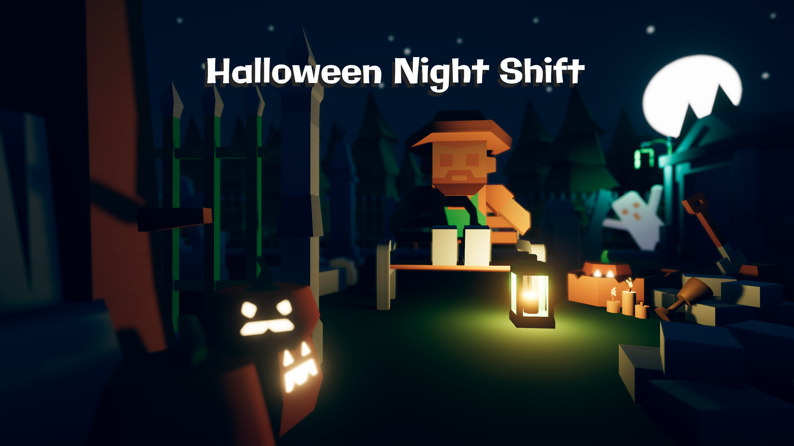
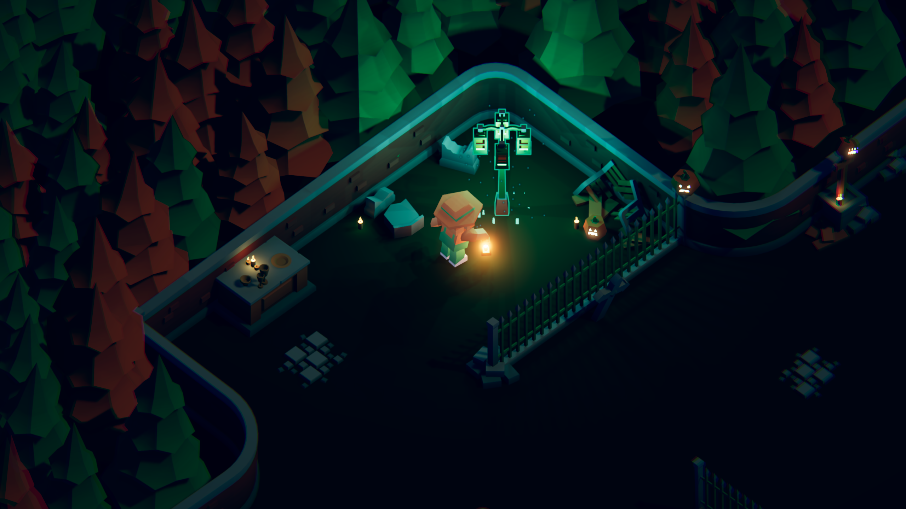
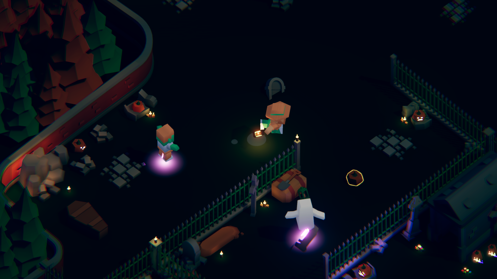
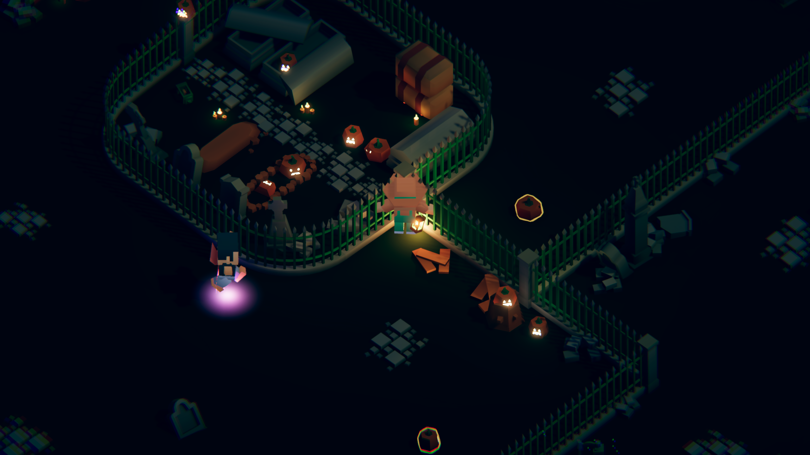
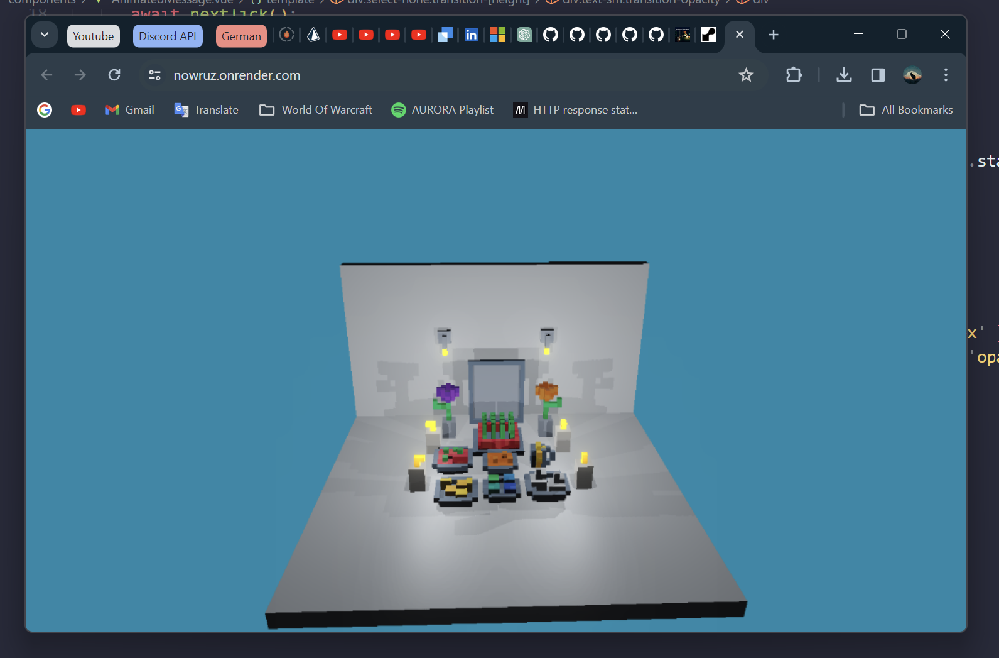

## Hello there 👋
I'm Matin Tat and here is where you can see what I'm working on or what I've done!

## My Projects
My Projects are listed here from the most recent
### Huginn
A Chat Application inspired by discord and north mythology. Designed to be a new home for people who need a bit of taste in their everyday life, but also functionality like we are all used to.

The name is from one of Odin's crows which means _"Thoughts"_

The whole project is open-source and you can check it out here: https://github.com/WerdoxDev/huginn.
Website is at: https://huginn.dev

### Holloween Night Shift
This is a arcade PC game made with unity about a farmer who is fighting against ghosts to save Holloween!

You can play it on https://skyblade-games.itch.io/halloween-night-shift!

  
  

  
  

### Nowruz Display
This is a special project I did to celebrate Persian new year!

It's a website with a 3D model that represents the traditional table Persian people make to celebrate the new year.

You can check it out here: https://nowruz.onrender.com

And the repository is here: https://github.com/WerdoxDev/nowruz-display

### Lumenite
This was my first big project which was about managing simple electric devices remotely like lights, rgb light, temperature sensors...

Although work on this project has been stopped, I have learned some very valuable lessons from it.

Here are all the repositories associated with this project:
Code (the website): https://github.com/WerdoxDev/lumenite-core
JS API: https://github.com/WerdoxDev/lumenite-api-js
C# API: https://github.com/WerdoxDev/lumenite-api-csharp

And here is a video!

https://github.com/WerdoxDev/WerdoxDev/assets/32638453/c22cfeea-901f-4315-8f18-52fa8ca864ba

### Honorable Projects
Here are some very small or old projects

The Abyss (a simple sea related game): https://github.com/WerdoxDev/The-Abyss

Chat-Tokio (a console chat app written in rust): https://github.com/WerdoxDev/chat-tokio

Dakal (a student management app): https://github.com/WerdoxDev/dakal

Skyblade Launcher (an old attempt to create a desktop launcher for our game development team): https://github.com/WerdoxDev/skyblade-launcher

<!--

**WerdoxDev/WerdoxDev** is a ✨ _special_ ✨ repository because its `README.md` (this file) appears on your GitHub profile.

Here are some ideas to get you started:

- 🔭 I’m currently working on ...
- 🌱 I’m currently learning ...
- 👯 I’m looking to collaborate on ...
- 🤔 I’m looking for help with ...
- 💬 Ask me about ...
- 📫 How to reach me: ...
- 😄 Pronouns: ...
- ⚡ Fun fact: ...
-->
